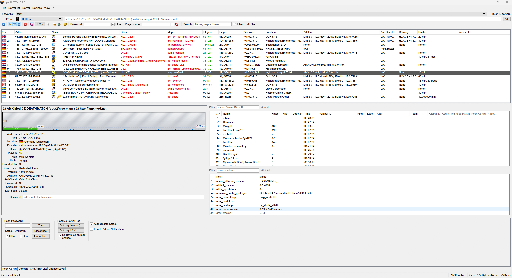
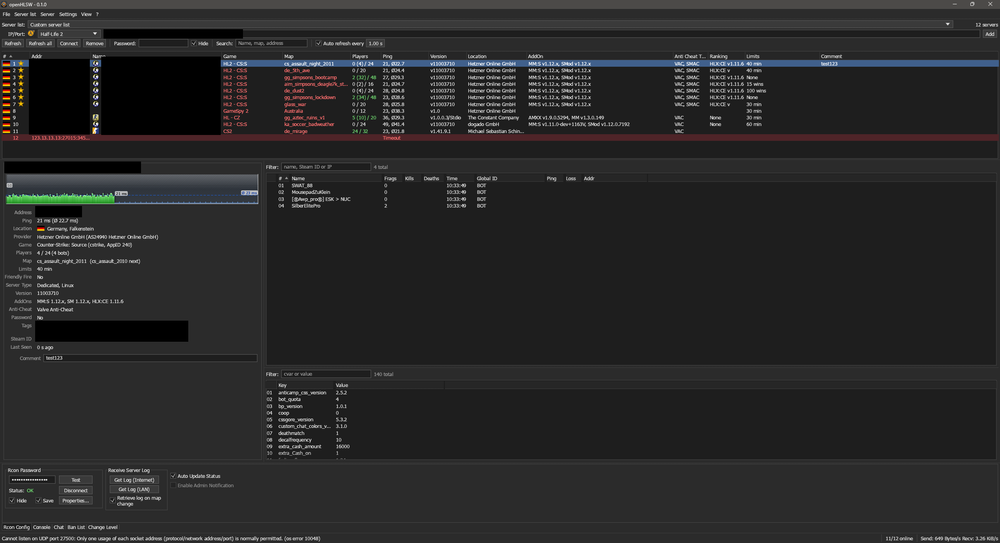

# openHLSW

A free remake of **HLSW** – the game server browser and RCON admin tool – for Windows,
Linux, macOS and FreeBSD, written in Rust. One native binary, no runtime needed.





**Supported servers**

- **Source (SRCDS)**: CS:S, CS:GO, CS2, TF2, HL2:DM, GMod, L4D and other Source games
- **Half-Life 1 / GoldSrc (HLDS)**: CS 1.6, Condition Zero, DoD, TFC, NS, TS and other mods
- **Every other game of HLSW's list and of [GameQ](https://github.com/Austinb/GameQ)'s list**
  (queries only, about 180 games): GameSpy 1 / 2 / 3 (Battlefield 1942 / 2 / 2142, Unreal
  Tournament, ArmA, Crysis, Halo …), Unreal 2 (UT2004, Killing Floor), Quake 1 / 2 / 3 (Call
  of Duty, Enemy Territory, Urban Terror, Warsow …), Doom 3, Frostbite (Battlefield Bad
  Company 2, 3, 4, Hardline), All-Seeing Eye (MTA, Far Cry, Soldat), Minecraft (Java and
  Bedrock), SA-MP, FiveM / RedM, Terraria (TShock), Teeworlds, OpenTTD, TeamSpeak 2 / 3,
  Ventrilo, Mumble and more; Valve games with an own query port (ARK, Squad, Rust …)

What changed between versions: [CHANGELOG.md](CHANGELOG.md).

## Download

Ready-made packages are on the [releases page](https://github.com/DennisPohlmann/openHLSW/releases/latest):

| System | Architectures | Packages |
|---|---|---|
| Windows 10 / 11 | x64, x86, ARM64 | `.msi` (setup wizard), `-portable.zip` |
| Linux | x86_64, aarch64 | `.deb`, `.rpm`, `.flatpak`, `.tar.gz` |
| Linux | riscv64 | `.deb`, `.rpm`, `.tar.gz` |
| macOS 11+ | universal (Apple silicon + Intel) | `.dmg`, `.zip` |
| FreeBSD 15 | x86_64 | `.tar.gz` |

- **Windows**: the `.msi` lets you choose the folder and adds a Start menu entry; updates
  keep your settings. The portable `.zip` runs from any folder.
- **Linux**: `.deb` / `.rpm` add a desktop entry; the binaries also run on older
  distributions. Flatpak: `flatpak install --user openhlsw-…flatpak`.
- **macOS**: drag openHLSW to Applications. The app is only ad-hoc signed: on the first
  start, right-click → Open (or `xattr -dr com.apple.quarantine /Applications/openHLSW.app`).
- **FreeBSD**: unpack the `.tar.gz` and start `openhlsw`.
- **Checksums**: every release has a `SHA256SUMS` file with the SHA-256 checksum of each
  package; check a download with `sha256sum --check --ignore-missing SHA256SUMS`.

**Languages**: English, German, French, Spanish (Argentina), Portuguese (Portugal), Dutch,
Danish, Swedish, Norwegian, Finnish, Polish, Czech, Slovak, Hungarian, Turkish, Russian,
Chinese (Simplified and Traditional) – the system language by default.

## Features

Layout, menus, toolbar and keyboard shortcuts like HLSW 1.4; skin White or Black.

**Server list**
- Several lists; add servers as `IP:port`, host name, `steam://connect/…` or
  `IP:gameport:queryport`. Game list like HLSW's (Auto detect, not detectable games, all
  games): Auto detect finds Valve, GameSpy 1 and GameSpy 2 servers; for the other games
  choose the game, the usual port and query port are filled in.
- Import Steam favorites, search the LAN, Multi Server Insert, filter, find (Ctrl+F / F3).
- Columns like HLSW: flag, name with game icon (and a key for servers with a password), game,
  map, players, ping (current + average), version, location and provider, add-ons (MM:S,
  SourceMod, AMXX, …), anti-cheat, limits, comment. Double-click a header to fit a column, right-click to show / hide columns.
- Refresh every second by default; offline servers turn red, keep their last infos and move
  to the end of the list.

**Server, players and rules**
- Server info with game icon and HLSW's ping graph (fixed scale, green → yellow → red);
  right-click a value (name, address, map, …) to copy it, its line or all details.
- Players with country flag and – via RCON `status` – ping, loss, Steam ID and IP;
  Battlefield 2 score, deaths, skill, team and bots straight from the query.
- Right-click menus like HLSW: copy (names, Steam IDs, profile URLs, rows), Steam profile,
  Global ID Database, kick and ban with a duration – Multi Kick / Multi Ban for several
  marked players. Rules: copy and change values.

**RCON** (Source over TCP, Half-Life 1 over UDP)
- Rcon Config with Auto Update Status and server log (Get Log LAN / Internet). Hide, Save,
  Auto Update Status and its interval (`status` every 30 s by default, 5–600 s) are kept
  per server.
- Console like HLSW (switches C * F D E A, find, history, Tab completion); every command a
  button sends is shown with the server's answer, and so is the periodic `status` of Auto
  Update Status (switch A hides it).
- Chat with Admin Notification, Ban List (with the Global ID Database), Change Level.

**More**
- Connect with player name, start parameters per game and server, password prompt and
  waiting for a free slot.
- Trace Route window with ping graph per hop; Global Player ID Database (`banned.cfg`
  import / export).
- Settings like HLSW: My Games, Startup, Connecting, Rcon, Connections, Sounds, Misc.
- Sharp text: ClearType-like sub-pixel text on Windows, Linux and macOS (automatically off
  on high-resolution screens), any installed font (shown in its own look), text size 12–16 px.
  openHLSW brings no fonts of its own.
- Typing in an open dropdown jumps to the matching entry ("de" → Deutsch).

**Not included on purpose**: HLSW login, buddy list, HLSW's web / global server lists (those
services are gone), Metamod plugin management.

## Good to know

- **Query limit**: srcds answers only `sv_max_queries_sec` queries per second per IP
  (default 3). openHLSW stays below it (Settings → Misc → Query limit, 2.5/s per server), so
  the refresh interval can go down to 0.4 s. After a timeout the rate for that server is
  lowered for a while. Timeouts usually mean a firewall or DDoS protection drops queries;
  raise the interval or lower the query limit then.
- **Other games**: Valve, GameSpy 1 and GameSpy 2 / 3 servers are detected automatically;
  GameSpy servers with an own query port are entered as `IP:gameport:queryport`. For all
  other games choose the game in the IP/Port list before adding: its usual port and query
  port are filled in. These servers have no RCON; Battlefield 2 / 2142 are joined directly on
  Connect.
- **RCON password**: the server is only asked with it when you click Test (or press Enter)
  or send a command, never while typing; after "Bad password" openHLSW does not try again by
  itself (servers ban addresses after a few failed logins).
- **Location** of servers and players comes from ip-api.com (cached, local addresses are not
  looked up); it can be switched off in Settings → Misc.
- **Server log / chat**: "Get Log" sends `logaddress_add` and `log on`. The UDP port (default
  27500, Settings → Connections) must be reachable – for Internet forwarded in your router.
  openHLSW does that by itself with UPnP while it receives logs (and removes the forwarding
  on exit); it can be switched off in Settings → Connections. It needs UPnP enabled in the
  router (FRITZ!Box: "Permit independent port sharing") and a public IPv4 address – with
  CGNAT / DS-Lite no forwarding helps. Without UPnP, forward the port by hand.
- **Settings** are stored in `config.json` in `%APPDATA%\openHLSW` (Windows),
  `~/.config/openHLSW` (Linux, FreeBSD) or `~/Library/Application Support/openHLSW` (macOS).
  Saved RCON passwords are stored there as plain text.

## Building

Rust (stable, ≥ 1.95, <https://rustup.rs>), then:

```sh
cargo build --release
```

This builds `openhlsw` (the GUI) and `openhlsw-cli` in `target/release/`.
Linux needs the OpenGL, X11 and Wayland development packages, e.g. on Debian / Ubuntu
`sudo apt install libxkbcommon-dev libgl1-mesa-dev libwayland-dev`; FreeBSD
`pkg install pkgconf libX11 libxkbcommon`.

**Packages and releases**: `.github/workflows/build.yml` checks and builds all packages of
the download table on every push to `main` and every pull request (as workflow artifacts).
Releases are made by [semantic-release](https://semantic-release.gitbook.io/) from the
[Conventional Commits](https://www.conventionalcommits.org/) since the last tag: a `feat`
(minor), `fix` / `perf` (patch) or breaking change (major) on `main` sets the version in
`Cargo.toml` and `Cargo.lock`, writes `CHANGELOG.md`, tags `vX.Y.Z` and publishes a GitHub
release with all packages and their `SHA256SUMS`. Never tag by hand. Packaging files are in `packaging/`
(Linux desktop entry and Flatpak, WiX installer, macOS `Info.plist`).

**Command line**:

```sh
openhlsw-cli 203.0.113.10:27015                  # query info, players, rules
openhlsw-cli 203.0.113.10:27015 RCON_PASSWORD status
openhlsw-cli 203.0.113.10:23459:34567            # query a GameSpy server
```

**Testing without a real server**: `tools/fake_srcds.py` simulates SRCDS (A2S, RCON, log),
with `--goldsrc` HLDS and with `--gamespy2 <queryport>` a GameSpy 2 server. Unit tests:
`cargo test`.

```sh
python3 tools/fake_srcds.py --port 27015 --password secret
cargo run   # then add 127.0.0.1:27015, RCON password "secret"
```

## Code

```
src/
  address.rs, a2s.rs, gamespy2.rs, rcon.rs   addresses, Valve / GameSpy 2 queries, RCON
  upnp.rs                                    port forwarding in the router (UPnP IGD)
  query/                                     the other query protocols (GameSpy 1, Quake,
                                             Unreal, TeamSpeak, Minecraft, SA-MP, …)
  worker.rs                                  background threads (queries, RCON, log listener)
  app.rs, settings.rs, native_window.rs      user interface and dialogs
  theme.rs, toolbar_icons.rs, typeahead.rs   look, fonts, toolbar icons, dropdown search
  games.rs, game_icons.rs, flags.rs          game list, icons, country flags
  filter.rs, iddb.rs, discover.rs            filter, Global ID Database, Steam favorites / LAN
  geo.rs, trace.rs, stats.rs                 location, Trace Route, traffic counters
  i18n.rs, config.rs                         languages, settings file
  bin/openhlsw-cli.rs                        command line tool
vendor/      egui's painting crates with sub-pixel text, see vendor/README.md
assets/      icons, flags, translations (assets/lang/*.json)
packaging/   packages and installer
tools/       test server, version script for releases
```

**Translations**: the English text in the code is the key (`tr!("Refresh")`,
`tr!("Added {count} servers", count = n)`); each language is a JSON file in `assets/lang/`
mapping it to the translation. Missing entries fall back to English; `cargo test` checks the
`{placeholders}`.

**Ideas for later**: ARK: Survival Ascended (needs an Epic login), GTA Network / RAGE MP
(their server lists need HTTPS), system tray, View Manager.

## License

openHLSW is free software under the [GNU General Public License v3.0 or later](LICENSE).
Copyright (C) 2026 the openHLSW contributors.

The game icons in `assets/games/` are **not** covered by this license: they show logos and
artwork of the respective games, all rights belong to their owners, see
[`assets/games/NOTICE.txt`](assets/games/NOTICE.txt). The country flags are public domain
(`assets/FLAGS-LICENSE.txt`). The modified egui crates in `vendor/` are under MIT or
Apache-2.0. openHLSW includes no fonts. openHLSW is not affiliated with the original HLSW or
with any game publisher. The license and these notices are also shown in the program under
**? → License**.
